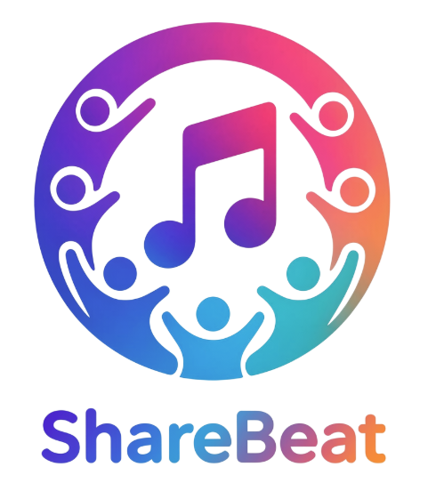
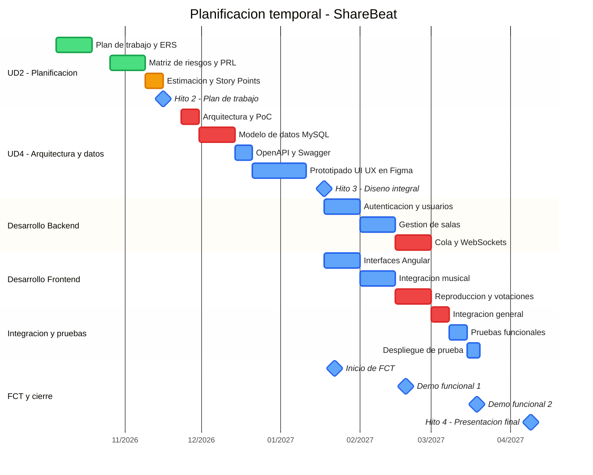

## Definición del Alcance, Estimación por Story Points y Diagrama de Gantt

**Módulo:** Proyecto Intermodular - 2º DAW

**Equipo de desarrollo:**
- Alejandro López Jiménez
- Laura Sierra Arrabal
- María Victoria Depaoli

**Repositorio:** https://github.com/vicky-dep/sharebeat

**Fecha de entrega:** 15 de noviembre de 2026

## 1. Definición del alcance del MVP

### 1.1. Resumen ejecutivo

ShareBeat es una plataforma web gratuita que permitirá a los usuarios escuchar música de forma colaborativa mediante salas virtuales.

El Producto Mínimo Viable (MVP) permitirá registrarse, iniciar y cerrar sesión, crear salas públicas o privadas y acceder a ellas mediante enlaces o códigos de invitación. Todos los participantes deberán disponer de una cuenta para utilizar la plataforma.

Dentro de las salas, los usuarios podrán seleccionar canciones de YouTube y SoundCloud, añadirlas a una cola compartida, votar sus favoritas y escuchar música de forma sincronizada. La comunicación en tiempo real se gestionará mediante WebSockets.

La primera versión se desarrollará con Angular 20, Spring Boot 3.5, MySQL 8.4 y Docker, priorizando las funcionalidades esenciales para ofrecer una experiencia musical colaborativa.

### 1.2. Tabla de alcance: In-Scope vs. Out-of-Scope

| Alcance | Funcionalidad | Descripción y justificación |
|---|---|---|
| In-Scope | Autenticación y usuarios | Registro, inicio y cierre de sesión, gestión básica del perfil y acceso obligatorio mediante cuenta. |
| In-Scope | Gestión de salas | Creación de salas públicas y privadas y acceso mediante código o enlace de invitación. |
| In-Scope | Catálogo musical | Selección de canciones de YouTube y SoundCloud mediante sus reproductores e integraciones oficiales. |
| In-Scope | Cola colaborativa | Incorporación de canciones a una cola compartida, visible para todos los participantes. |
| In-Scope | Sincronización en tiempo real | Reproducción coordinada y actualización de participantes y cola mediante WebSockets. |
| In-Scope | Votaciones musicales | Votación de canciones para establecer su prioridad en la cola de reproducción. |
| Out-of-Scope | Aplicaciones móviles nativas | No se desarrollarán aplicaciones independientes para Android o iOS; se priorizará una web adaptable a distintos dispositivos. |
| Out-of-Scope | Almacenamiento propio de música | ShareBeat no alojará ni distribuirá archivos de audio, utilizando los reproductores oficiales de los proveedores. |
| Out-of-Scope | Funcionalidades avanzadas | Se posponen las recomendaciones mediante IA, el chat de voz y las suscripciones de pago. |

La integración de YouTube y SoundCloud deberá validarse técnicamente para comprobar la disponibilidad de contenido, las condiciones de uso y las posibilidades de sincronización.

## 2. Product Backlog estimado

El Product Backlog está formado por 12 historias de usuario distribuidas en las tres épicas principales del proyecto.

Las estimaciones utilizan la serie de Fibonacci modificada (1, 2, 3, 5, 8, 13, 20), considerando la complejidad técnica, el volumen de trabajo y la incertidumbre de cada funcionalidad.

### 2.1. Épica 1: Autenticación y gestión de usuarios

#### US01 - Registro de usuarios

**Historia de usuario:** Como visitante, quiero registrarme mediante correo electrónico y contraseña para disponer de una cuenta y acceder a ShareBeat.

**Criterios de aceptación:**
1. El formulario valida el formato del correo y los requisitos de la contraseña.
2. El sistema impide registrar correos duplicados y almacena las contraseñas mediante un hash seguro.

**Estimación:** 5 SP.

**Justificación:** Requiere validaciones en frontend y backend, seguridad y persistencia en MySQL.

#### US02 - Inicio y cierre de sesión

**Historia de usuario:** Como usuario registrado, quiero iniciar y cerrar sesión para acceder de forma segura a la plataforma.

**Criterios de aceptación:**
1. El sistema permite acceder con credenciales válidas y muestra un error cuando son incorrectas.
2. Al cerrar sesión, se elimina la autenticación activa del cliente y se impide acceder a las áreas protegidas sin volver a autenticarse.

**Estimación:** 3 SP.

**Justificación:** Requiere implementar la autenticación y proteger las rutas y servicios correspondientes.

#### US03 - Modificación del perfil

**Historia de usuario:** Como usuario registrado, quiero consultar y modificar los datos básicos de mi perfil para mantener mi información actualizada.

**Criterios de aceptación:**
1. El usuario puede consultar y modificar su nombre visible y otros datos básicos permitidos.
2. Los cambios se validan y permanecen guardados después de cerrar y volver a iniciar sesión.

**Estimación:** 3 SP.

**Justificación:** Implica operaciones CRUD y validaciones de datos en frontend y backend.

#### US04 - Eliminación de cuenta

**Historia de usuario:** Como usuario registrado, quiero eliminar mi cuenta para dejar de utilizar ShareBeat.

**Criterios de aceptación:**
1. El sistema solicita confirmación antes de eliminar la cuenta.
2. Se eliminan o anonimizan los datos personales correspondientes y el usuario deja de poder iniciar sesión.

**Estimación:** 5 SP.

**Justificación:** Requiere gestionar relaciones entre entidades, seguridad y tratamiento de datos personales.

### 2.2. Épica 2: Gestión de salas y colaboración

#### US05 - Creación de salas musicales

**Historia de usuario:** Como usuario registrado, quiero crear una sala musical para compartir música con otros usuarios.

**Criterios de aceptación:**
1. El sistema crea una sala con un identificador único.
2. El usuario creador queda registrado como administrador de la sala.

**Estimación:** 5 SP.

**Justificación:** Requiere implementar entidades, relaciones y permisos básicos.

#### US06 - Acceso mediante invitación

**Historia de usuario:** Como usuario registrado, quiero acceder a una sala mediante un código o enlace para participar en una sesión musical.

**Criterios de aceptación:**
1. Un usuario autenticado puede acceder mediante un código o enlace válido.
2. El sistema muestra un mensaje de error cuando la sala no existe o el acceso no está permitido.

**Estimación:** 3 SP.

**Justificación:** Requiere validar identificadores y gestionar la navegación y el acceso a las salas.

#### US07 - Configuración de privacidad

**Historia de usuario:** Como creador de una sala, quiero configurar su privacidad para controlar quién puede acceder.

**Criterios de aceptación:**
1. El administrador puede establecer la sala como pública o privada.
2. El sistema aplica las restricciones de acceso y conserva la configuración.

**Estimación:** 5 SP.

**Justificación:** Incluye permisos, comprobaciones de acceso y persistencia.

#### US08 - Visualización de participantes

**Historia de usuario:** Como participante de una sala, quiero ver qué usuarios están conectados para conocer quién está escuchando música conmigo.

**Criterios de aceptación:**
1. La interfaz muestra los participantes conectados.
2. La lista se actualiza mediante WebSockets cuando un usuario entra o abandona la sala, sin recargar la página.

**Estimación:** 5 SP.

**Justificación:** Requiere gestionar conexiones y actualizar la interfaz en tiempo real.

### 2.3. Épica 3: Reproducción, listas y catálogo musical

#### US09 - Selección de canciones

**Historia de usuario:** Como participante de una sala, quiero seleccionar canciones de YouTube y SoundCloud para añadirlas a la sesión musical.

**Criterios de aceptación:**
1. El usuario puede seleccionar una canción válida de cualquiera de los dos proveedores y visualizar su información disponible.
2. El sistema identifica el proveedor y muestra un mensaje cuando el contenido no está disponible.

**Estimación:** 5 SP.

**Justificación:** Requiere integrar dos proveedores y adaptar sus datos a un formato común.

#### US10 - Cola de reproducción colaborativa

**Historia de usuario:** Como participante de una sala, quiero añadir canciones a una cola compartida para colaborar en la selección musical.

**Criterios de aceptación:**
1. Los participantes pueden añadir canciones sin sobrescribir las aportaciones de otros usuarios.
2. La cola se actualiza para todos los participantes conectados sin recargar la página.

**Estimación:** 5 SP.

**Justificación:** Requiere gestionar una estructura compartida y comunicar los cambios mediante WebSockets.

#### US11 - Reproducción sincronizada

**Historia de usuario:** Como participante de una sala, quiero escuchar la misma canción que los demás usuarios para compartir una experiencia musical conjunta.

**Criterios de aceptación:**
1. Los eventos de reproducción, pausa y cambio de canción se comunican a todos los participantes.
2. En una prueba con al menos tres usuarios, la diferencia de reproducción entre clientes se mantiene por debajo de 2 segundos en condiciones normales de conexión.

**Estimación:** 13 SP.

**Justificación:** Es la funcionalidad de mayor complejidad debido a la latencia, los WebSockets y las diferencias entre los reproductores de YouTube y SoundCloud.

#### US12 - Votación de canciones

**Historia de usuario:** Como participante de una sala, quiero votar las canciones propuestas para influir en el orden de reproducción.

**Criterios de aceptación:**
1. Cada usuario puede emitir un voto por canción.
2. La cola se reordena según los votos recibidos y el cambio se refleja para todos los participantes.

**Estimación:** 8 SP.

**Justificación:** Requiere controlar votos duplicados, actualizar prioridades y sincronizar los cambios en tiempo real.

### 2.4. Resumen de estimaciones

| Épica | Historias | Story Points |
|---|---|---:|
| Autenticación y usuarios | US01-US04 | 16 |
| Salas y colaboración | US05-US08 | 18 |
| Reproducción y catálogo | US09-US12 | 31 |
| **Total** | **12 historias** | **65 SP** |

**Carga total estimada del MVP: 65 Story Points.**

Las estimaciones podrán revisarse durante el desarrollo, especialmente las funcionalidades relacionadas con la integración musical y la sincronización.

## 3. Matriz RACI de responsabilidades

La matriz RACI distribuye las responsabilidades de las principales tareas del proyecto entre los roles técnicos del equipo.

- **R (Responsible):** Ejecuta el trabajo.
- **A (Accountable):** Asume la responsabilidad final y aprueba el resultado.
- **C (Consulted):** Es consultado durante la realización.
- **I (Informed):** Recibe información sobre el avance.

Cada tarea tiene un único rol Accountable (A). Un mismo rol puede asumir simultáneamente A y R.

| Tarea / Entregable | DevOps | Backend | Frontend | QA/DBA |
|---|:---:|:---:|:---:|:---:|
| Configuración de Docker Compose | A/R | C | I | C |
| Diseño del modelo de datos MySQL | I | R | C | A |
| Implementación de autenticación y API REST | I | A/R | C | C |
| Desarrollo de salas y permisos | I | A/R | C | C |
| Implementación de WebSockets y sincronización | C | A/R | R | C |
| Desarrollo de interfaces Angular | I | C | A/R | C |
| Integración de YouTube y SoundCloud | I | R | A/R | C |
| Gestión de cola y votaciones | I | A/R | R | C |
| Pruebas unitarias y de integración | C | R | R | A |
| Despliegue de la aplicación | A/R | C | I | C |

## 4. Diagrama de Gantt del proyecto

El siguiente diagrama representa la planificación temporal de ShareBeat, incluyendo las fases de diseño, desarrollo backend y frontend, integración, pruebas y despliegue.

Se respetan las fechas de planificación y diseño del calendario facilitado por el profesor, así como el inicio de FCT el 22 de enero de 2027. Las fechas posteriores al Hito 3 son estimaciones del equipo, pendientes de confirmación para los hitos finales.

### 4.1. Diagrama de Gantt

### 4.2. Dependencias entre tareas

Las dependencias son de tipo Fin-Inicio (FS): una tarea comienza cuando finaliza su predecesora.

| Tarea predecesora | Tarea sucesora |
|---|---|
| Arquitectura y PoC | Modelo de datos MySQL |
| Modelo de datos MySQL | OpenAPI y Swagger |
| Hito 3: Diseño integral | Autenticación y usuarios |
| Hito 3: Diseño integral | Interfaces Angular |
| Autenticación y usuarios | Gestión de salas |
| Gestión de salas | Cola y WebSockets |
| Interfaces Angular | Integración musical |
| Integración musical | Reproducción y votaciones |
| Finalización del backend y frontend | Integración general |
| Integración general | Pruebas funcionales |
| Pruebas funcionales | Despliegue de prueba |

El desarrollo backend y frontend se realizará en paralelo. La integración comenzará cuando ambas partes estén finalizadas.

**Nota:** Las fechas de las demos funcionales y del Hito 4 son propuestas de planificación.