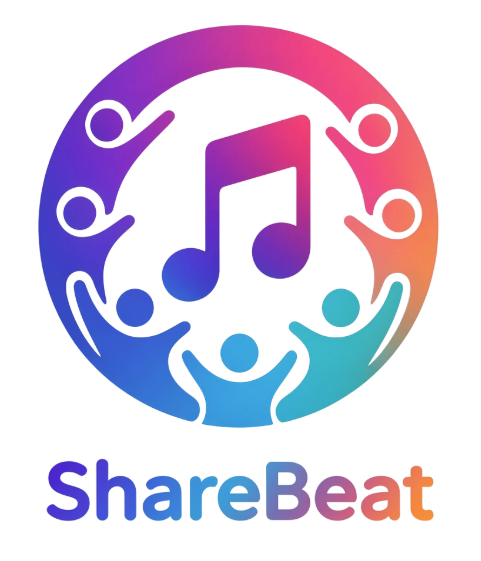
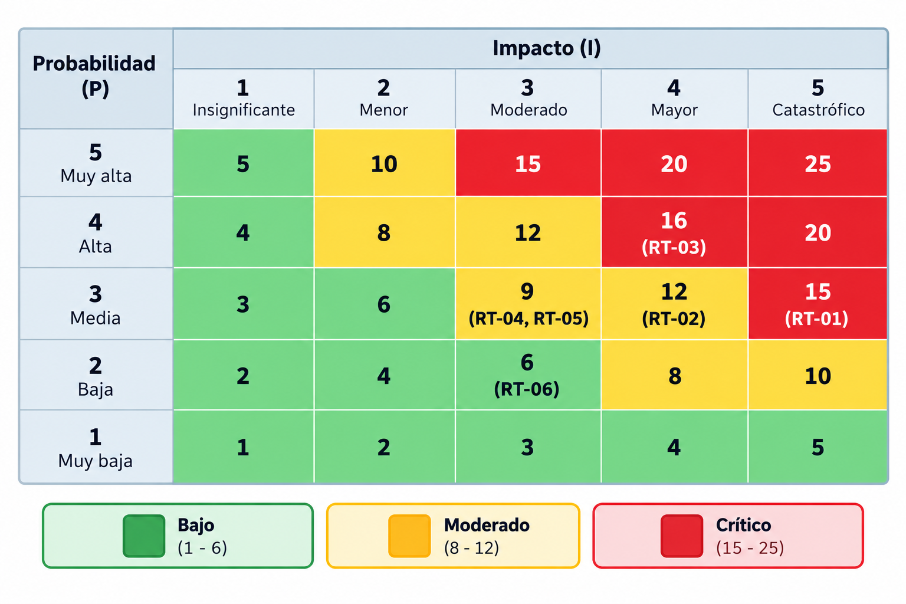

## Matriz de Riesgos Técnicos, Plan de Contingencia y Prevención de Riesgos Laborales

**Módulo:** Proyecto Intermodular - 2º DAW

**Equipo:**
- Alejandro López Jiménez
- Laura Sierra Arrabal
- María Victoria Depaoli

**Repositorio:** https://github.com/vicky-dep/sharebeat

**Fecha de entrega:** 1 de noviembre de 2026

## 1. Identificación y registro de riesgos técnicos

Durante el desarrollo de ShareBeat hemos identificado seis riesgos técnicos que podrían afectar al funcionamiento de la aplicación y a la organización del equipo.

En el ámbito de la **seguridad**, existe el riesgo de publicar accidentalmente contraseñas de la base de datos o claves de servicios externos en GitHub. Respecto a la **base de datos**, podrían producirse pérdidas de información por errores durante las migraciones o por la eliminación accidental de volúmenes de Docker.

En el **backend**, uno de los principales desafíos será conseguir que todos los usuarios de una misma sala escuchen la música de forma sincronizada. Los errores de comunicación mediante WebSockets o los problemas de latencia podrían provocar diferencias en la reproducción.

En cuanto al **frontend**, podrían aparecer dificultades al integrar Angular con Spring Boot, especialmente en la comunicación con las API, el intercambio de datos y la configuración de CORS.

También debemos considerar los riesgos relacionados con la **infraestructura**, como los conflictos de puertos o las diferencias de configuración de Docker entre los ordenadores del equipo.

Por último, al tratarse de un proyecto desarrollado por tres integrantes, podrían producirse **conflictos al trabajar con Git**, especialmente cuando varias personas modifiquen los mismos archivos o integren cambios en el repositorio.

## 2. Matriz de evaluación de riesgos técnicos

Para evaluar los riesgos utilizamos una escala del 1 al 5 para la probabilidad (P) y el impacto (I):

- **Probabilidad (P):** 1 = Muy baja, 2 = Baja, 3 = Media, 4 = Alta, 5 = Muy alta.
- **Impacto (I):** 1 = Insignificante, 2 = Menor, 3 = Moderado, 4 = Mayor, 5 = Catastrófico.

El nivel de riesgo se calcula mediante la fórmula:

**R = P × I**

Los resultados se clasifican en tres niveles:

- **Bajo (Verde):** 1-6.
- **Moderado (Amarillo):** 8-12.
- **Crítico (Rojo):** 15-25.

### 2.1. Tabla de identificación y evaluación de riesgos

| Código | Dimensión | Descripción del riesgo | Probabilidad (P) | Impacto (I) | Severidad (R = P × I) | Nivel / Color |
|---|---|---|---:|---:|---:|---|
| RT-01 | Seguridad / DevOps | Filtración accidental de credenciales de MySQL o claves de API en GitHub, por ejemplo, al subir el archivo `.env`. | 3 | 5 | **15** | Crítico (Rojo) |
| RT-02 | Base de datos / Backend | Pérdida de datos de MySQL por errores durante migraciones o eliminación accidental de volúmenes Docker. | 3 | 4 | **12** | Moderado (Amarillo) |
| RT-03 | Comunicaciones / Backend | Fallos de sincronización musical entre usuarios de una misma sala debido a problemas de latencia o comunicación mediante WebSockets. | 4 | 4 | **16** | Crítico (Rojo) |
| RT-04 | Arquitectura / Frontend | Errores de integración entre Angular 20 y Spring Boot por diferencias en rutas, formatos JSON o configuración de CORS. | 3 | 3 | **9** | Moderado (Amarillo) |
| RT-05 | Infraestructura / Docker | Conflictos de puertos o configuraciones diferentes al ejecutar los contenedores en los equipos de desarrollo. | 3 | 3 | **9** | Moderado (Amarillo) |
| RT-06 | Factores humanos / Git | Conflictos de fusión (*merge conflicts*) o pérdida de cambios por una gestión incorrecta de ramas. | 2 | 3 | **6** | Bajo (Verde) |

### 2.2. Matriz de severidad 5 × 5

La siguiente matriz representa la ubicación de los riesgos según su probabilidad e impacto.

Los tres riesgos de mayor severidad son RT-03, RT-01 y RT-02, por lo que desarrollamos sus planes de contingencia a continuación.

## 3. Fichas de contingencia

### 3.1. RT-03 - Fallos de sincronización musical

**Código:** RT-03

**Descripción:** Los usuarios de una misma sala podrían escuchar una canción en momentos diferentes debido a problemas de latencia, pérdida de conexión o errores de comunicación mediante WebSockets.

**Probabilidad:** 4  
**Impacto:** 4  
**Severidad:** 16 - Crítico (Rojo)

**Disparador (Trigger):**

Durante una prueba con al menos tres usuarios conectados a la misma sala, se detecta una diferencia de reproducción superior a 2 segundos entre dos clientes durante dos comprobaciones consecutivas.

**Medidas preventivas:**

- Mantener en el backend el estado de reproducción de cada sala.
- Utilizar WebSockets para comunicar los eventos de reproducción, pausa y cambio de canción.
- Utilizar marcas de tiempo para calcular la posición de reproducción.
- Realizar pruebas con varios usuarios conectados simultáneamente.
- Comprobar la reconexión de los usuarios que pierdan temporalmente la conexión.

**Plan de contingencia (Plan B):**

1. Identificar la sala afectada y los usuarios que presentan diferencias en la reproducción.
2. Revisar los registros del backend mediante `docker compose logs backend` y comprobar el estado de las conexiones WebSocket.
3. Consultar el estado de reproducción almacenado en el servidor, incluyendo la canción actual, su posición y la última marca de tiempo.
4. Enviar nuevamente el estado de reproducción a los clientes afectados para resincronizarlos.
5. Si el problema continúa, pausar temporalmente la reproducción de la sala y realizar una nueva sincronización.
6. Comprobar que los clientes afectados recuperan la conexión y reciben correctamente los eventos de reproducción.
7. Repetir la prueba con al menos tres usuarios y verificar que la diferencia de reproducción se mantiene por debajo de 2 segundos.
8. Registrar el fallo y aplicar las correcciones necesarias antes de recuperar el funcionamiento normal.

**Responsable:** Alejandro - Responsable de reproducción y catálogo, con colaboración del equipo.

### 3.2. RT-01 - Filtración de credenciales en GitHub

**Código:** RT-01

**Descripción:** Un integrante del equipo podría subir accidentalmente al repositorio de GitHub un archivo con contraseñas de MySQL, tokens o claves de acceso a servicios externos.

**Probabilidad:** 3  
**Impacto:** 5  
**Severidad:** 15 - Crítico (Rojo)

**Disparador (Trigger):**

Detección de al menos una credencial real en un commit publicado o mediante una alerta de seguridad de GitHub.

**Medidas preventivas:**

- Excluir el archivo `.env` mediante `.gitignore`.
- Utilizar `.env.example` sin contraseñas reales.
- Revisar los archivos antes de cada commit mediante `git status`.
- No incluir credenciales directamente en el código fuente.
- Utilizar contraseñas diferentes para los distintos entornos.

**Plan de contingencia (Plan B):**

1. Identificar la credencial filtrada y el servicio afectado.
2. Revocar o cambiar inmediatamente la contraseña o clave comprometida desde el servicio correspondiente.
3. Comprobar si se han producido accesos no autorizados.
4. Eliminar la credencial del código y sustituirla por una variable de entorno.
5. Si se ha subido el archivo `.env`, retirarlo del seguimiento de Git mediante `git rm --cached .env` desde la ubicación correspondiente y comprobar que está incluido en `.gitignore`.
6. Revisar si el secreto continúa accesible en el historial de Git. Si es necesario limpiarlo, coordinar la operación con todo el equipo para evitar la pérdida de cambios.
7. Configurar las nuevas credenciales en los archivos `.env` locales.
8. Reiniciar los servicios afectados y comprobar que la aplicación funciona correctamente con las nuevas credenciales.

**Responsable:** María Victoria - Responsable de autenticación y usuarios, con colaboración del equipo.

### 3.3. RT-02 - Pérdida de datos de MySQL

**Código:** RT-02

**Descripción:** La información almacenada en MySQL podría perderse por errores durante las migraciones, modificaciones de la base de datos o eliminación accidental de los volúmenes de Docker.

**Probabilidad:** 3  
**Impacto:** 4  
**Severidad:** 12 - Moderado (Amarillo)

**Disparador (Trigger):**

El contenedor MySQL falla al arrancar en dos intentos consecutivos o se detecta la pérdida de al menos una tabla o conjunto de datos que existía anteriormente.

**Medidas preventivas:**

- Utilizar volúmenes persistentes en Docker Compose.
- Evitar ejecutar `docker compose down -v` sin comprobar sus consecuencias.
- Realizar copias de seguridad antes de modificar la estructura de la base de datos.
- Mantener los scripts de creación y migración de la base de datos bajo control de versiones cuando se desarrollen.

**Plan de contingencia (Plan B):**

1. Revisar el estado de los contenedores mediante `docker compose ps`.
2. Consultar los errores de MySQL con `docker compose logs database`.
3. Comprobar la existencia del volumen de datos mediante `docker volume ls`, sin eliminarlo.
4. Si el problema es de configuración, corregirlo y reiniciar el servicio con `docker compose restart database`.
5. Si se han perdido datos, identificar la última copia de seguridad válida y restaurarla mediante las herramientas de MySQL.
6. Si no existe una copia recuperable y solo se trata de datos de prueba, reconstruir la base de datos a partir de los scripts de creación y carga de datos del proyecto, cuando estén disponibles.
7. Comprobar que el contenedor vuelve a estar operativo mediante `docker compose ps`.
8. Revisar los registros del backend con `docker compose logs backend` y verificar que Spring Boot se conecta correctamente a MySQL.
9. Comprobar que las tablas y los datos recuperados están disponibles.

**Responsable:** Laura – Responsable de salas y colaboración, con colaboración del equipo.

## 4. Plan de ergonomía, salud y prevención de riesgos laborales (PRL)

### 4.1. Ergonomía del puesto de trabajo

Para prevenir molestias físicas durante las sesiones de programación, aplicaremos las siguientes medidas:

- Utilizar una silla que permita mantener la espalda apoyada y los pies sobre el suelo.
- Colocar la parte superior del monitor aproximadamente a la altura de los ojos, a una distancia de 40-50 cm.
- Mantener los antebrazos apoyados y los codos formando aproximadamente un ángulo de 90°.
- Colocar el teclado y el ratón de forma que las muñecas permanezcan relajadas.
- Trabajar con iluminación suficiente y evitar reflejos sobre la pantalla.
- Cambiar de postura y levantarse periódicamente para evitar molestias musculares.

### 4.2. Gestión de la carga mental y descansos

Para reducir la fatiga visual aplicaremos la **regla 20-20-20**: cada 20 minutos frente a la pantalla, mirar durante al menos 20 segundos a un punto situado aproximadamente a 6 metros.

Durante las sesiones largas también podremos utilizar la **técnica Pomodoro**, trabajando durante 25 minutos y descansando 5 minutos, con pausas más largas después de varios ciclos.

Para evitar la sobrecarga de trabajo y la fatiga cognitiva:

- Organizaremos las tareas mediante GitHub Projects.
- Repartiremos las responsabilidades según las áreas del proyecto.
- Dividiremos las funcionalidades grandes en tareas más pequeñas.
- Priorizaremos las funcionalidades esenciales.
- Evitaremos trabajar simultáneamente en demasiadas tareas.
- Alternaremos actividades de alta concentración, como la depuración de errores, con otras de menor carga mental, como la documentación o revisión del código.
- Comunicaremos los bloqueos técnicos para buscar soluciones entre todos.
- Planificaremos las entregas con antelación para evitar jornadas excesivas.

### 4.3. Derecho a la desconexión digital

Nos comprometemos a respetar el tiempo personal y de descanso de los integrantes del equipo.

Fuera del horario acordado para trabajar en ShareBeat, no será obligatorio responder inmediatamente a mensajes, correos o notificaciones de GitHub.

Las comunicaciones no urgentes podrán atenderse durante la siguiente sesión de trabajo, evitando que el proyecto interfiera innecesariamente en el descanso y la vida personal.